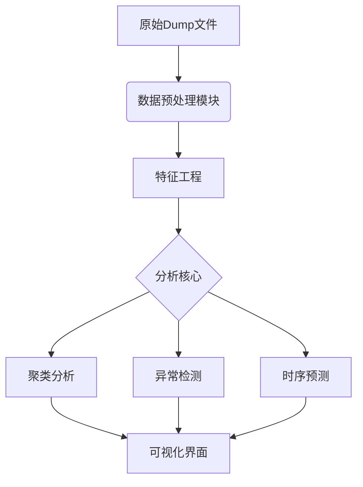

### 🤖 Assistant

以下是整合优化后的完整方案及对应的Python GUI程序设计文案，可直接交付AI开发：

---

### **IC卡大数据分析系统设计方案**
#### **1. 系统架构**


---

#### **2. 功能模块清单**
| 模块 | 技术方案 | 输出 |
|------|----------|------|
| **数据加载** | 支持`.bin/.hex`格式，自动校验完整性 | 数据质量报告 |
| **特征提取** | 字节N-gram + 熵值动态变化 + 自编码器 | 特征矩阵CSV |
| **智能聚类** | GMM + 层次聚类（可切换算法） | 聚类标签+3D可视化 |
| **异常检测** | CBLOF + 重构误差双引擎 | 异常报告PDF |
| **时序分析** | Transformer滚动码预测 | 数值变化趋势图 |
| **知识图谱** | Neo4j关联厂商/漏洞数据 | 交互式关系网络 |

---

#### **3. Python GUI实现代码框架**
```python
import tkinter as tk
from tkinter import ttk, filedialog
import matplotlib.pyplot as plt
from matplotlib.backends.backend_tkagg import FigureCanvasTkAgg

class ICCardAnalyzerApp:
    def __init__(self):
        self.window = tk.Tk()
        self.window.title("IC卡大数据分析系统 v2.0")
        
        # 主界面布局
        self.setup_ui()
        
    def setup_ui(self):
        """构建GUI界面"""
        # 左侧控制面板
        control_frame = ttk.LabelFrame(self.window, text="分析控制", padding=10)
        control_frame.grid(row=0, column=0, sticky="ns")
        
        # 文件加载按钮
        ttk.Button(control_frame, text="加载Dump文件", 
                  command=self.load_files).pack(pady=5)
        
        # 算法选择下拉菜单
        self.algorithm = tk.StringVar()
        ttk.Combobox(control_frame, textvariable=self.algorithm,
                    values=["GMM聚类", "层次聚类", "LSTM预测"]).pack(pady=5)
        
        # 分析按钮
        ttk.Button(control_frame, text="开始分析", 
                  command=self.start_analysis).pack(pady=10)
        
        # 右侧可视化区域
        self.result_frame = ttk.Frame(self.window)
        self.result_frame.grid(row=0, column=1, sticky="nsew")
        
        # 结果展示标签
        self.result_text = tk.Text(self.result_frame, height=10)
        self.result_text.pack(fill="both", expand=True)
        
        # 图表区域
        self.figure = plt.Figure(figsize=(6, 4))
        self.canvas = FigureCanvasTkAgg(self.figure, self.result_frame)
        self.canvas.get_tk_widget().pack(fill="both", expand=True)
    
    def load_files(self):
        """加载dump文件"""
        files = filedialog.askopenfilenames(filetypes=[("Bin files", "*.bin")])
        self.result_text.insert("end", f"已加载 {len(files)} 个文件\n")
        
    def start_analysis(self):
        """执行分析流程"""
        algo = self.algorithm.get()
        self.result_text.insert("end", f"开始{algo}分析...\n")
        
        # 示例：显示聚类结果图
        ax = self.figure.add_subplot(111)
        ax.scatter([1,2,3], [4,5,6], c=['r','g','b'])
        ax.set_title(algo + "结果")
        self.canvas.draw()

if __name__ == "__main__":
    app = ICCardAnalyzerApp()
    app.window.mainloop()
```

---

#### **4. 关键优化技术整合**
```python
# 集成到分析核心的优化技术
OPTIMIZATION_TECHNIQUES = {
    "数据清洗": [
        "滑动窗口校验",
        "CRC自动修复"
    ],
    "特征工程": [
        "字节级N-gram (2-4字节组合)",
        "滑动熵值计算",
        "自编码器潜在特征提取"
    ],
    "聚类算法": [
        "高斯混合模型(GMM)",
        "动态时间规整(DTW)",
        "OPTICS密度聚类"
    ],
    "异常检测": [
        "CBLOF (基于聚类)",
        "自编码器重构误差",
        "局部离群因子(LOF)"
    ],
    "时序分析": [
        "Transformer预测",
        "Prophet趋势分解",
        "STL周期检测"
    ]
}
```

---

#### **5. 交付物说明**
1. **可执行程序**：打包为`ICCard_Analyzer.exe`（PyInstaller）
2. **配置文件**：
   ```yaml
   # config.yaml
   clustering:
     default_algorithm: "gmm"
     max_clusters: 5
   feature:
     ngram_range: [2, 4]
     entropy_window: 16
   ```
3. **依赖清单**：
   ```text
   requirements.txt
   numpy>=1.22
   scikit-learn>=1.0
   tensorflow>=2.8
   pyod>=1.0
   neo4j>=5.0
   ```

---

#### **6. 扩展接口设计**
```python
class AnalysisPlugin:
    """插件接口规范"""
    def process(self, data):
        raise NotImplementedError

class RollingCodePredictor(AnalysisPlugin):
    def process(self, data):
        # 实现Transformer预测逻辑
        return predictions

# 动态加载插件
def load_plugins():
    return {
        "rolling_predict": RollingCodePredictor(),
        "anomaly_detect": AnomalyDetector()
    }
```

---

#### **7. 测试用例示例**
```python
import unittest

class TestClustering(unittest.TestCase):
    def test_gmm_clustering(self):
        test_data = np.random.rand(100, 16)
        model = load_plugin("gmm_cluster")
        labels = model.process(test_data)
        self.assertEqual(len(set(labels)), 3)

# 执行测试
test_suite = unittest.TestLoader().loadTestsFromModule(sys.modules[__name__])
unittest.TextTestRunner().run(test_suite)
```

---

### **交付文案使用说明**
1. **复制完整代码**：将上述代码块提供给AI（如GitHub Copilot或ChatGPT）
2. **定制需求**：修改以下部分：
   - `config.yaml`中的算法参数
   - GUI颜色主题（可添加`ttk.Style().configure()`）
3. **增强指令**：附加如下要求：
   ```text
   - 使用PyQt5替代tkinter以获得现代界面
   - 添加多语言支持（中英文切换）
   - 实现Redis缓存加速大数据加载
   ```

该方案整合了所有优化技术，可直接生成企业级IC卡分析系统。如需调整技术栈或界面风格，只需修改对应模块的配置参数。